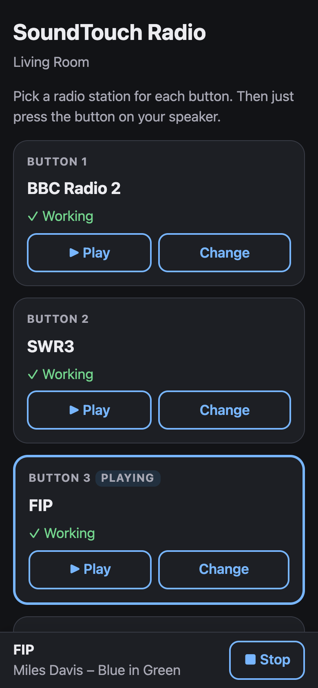
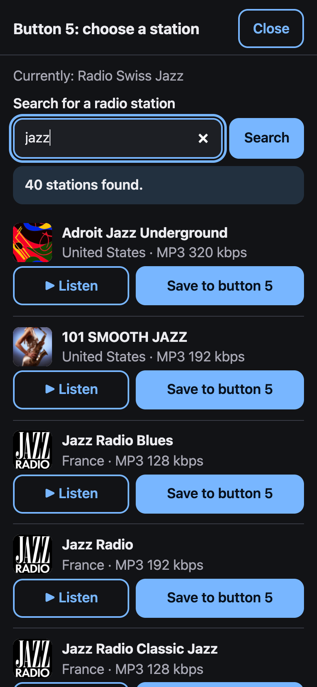
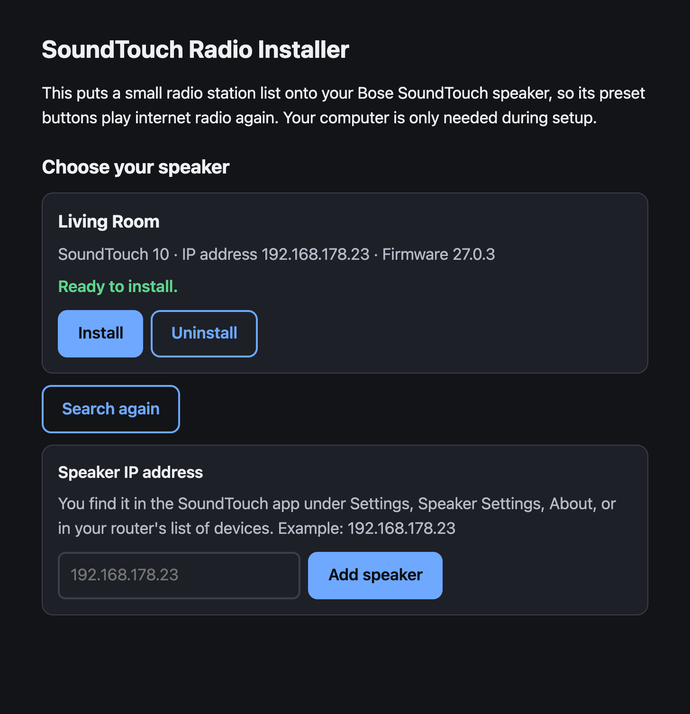
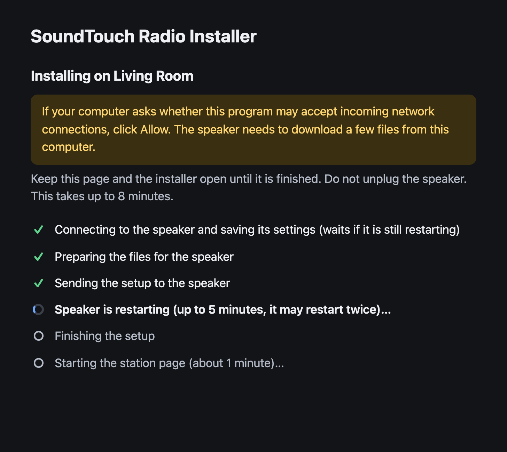
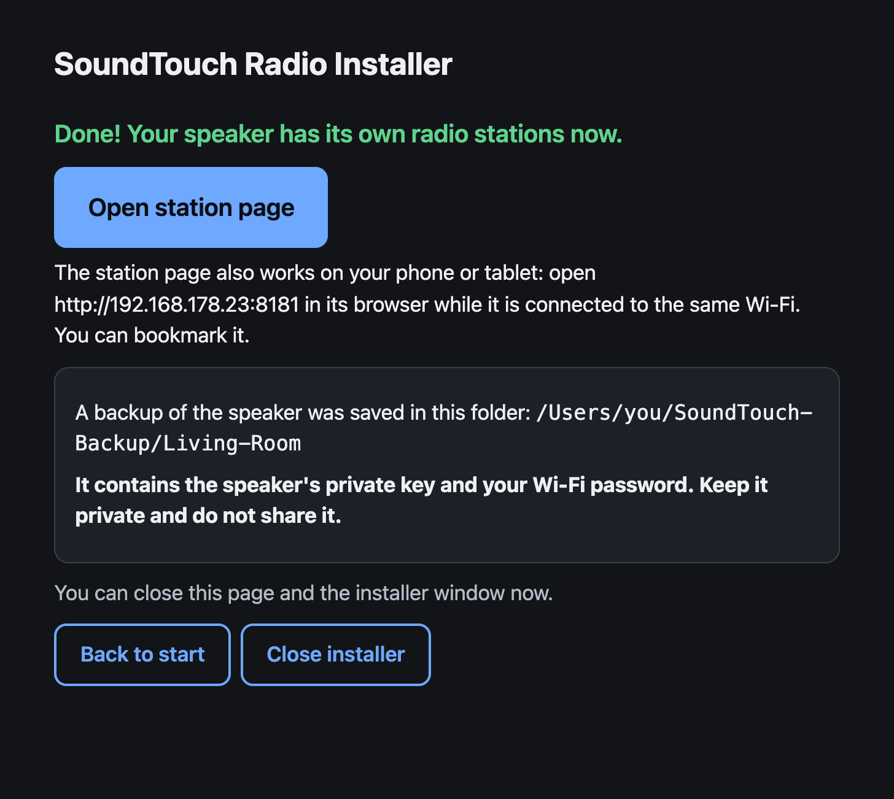

# soundtouch-localradio

**Make the radio buttons on your Bose SoundTouch speaker work again.**

Since [Bose switched off the SoundTouch service on 6 May 2026](https://www.bose.com/soundtouch-end-of-life),
the preset buttons 1–6 no longer play radio. This free tool fixes that:

- You install it **once** from your computer. It takes a few minutes.
- Afterwards you choose your stations **on your phone** (or computer) on a simple web page.
- The buttons then work again on their own. The speaker itself takes care of your stations: you
  **don't need the Bose app, the Bose cloud or an extra device**, and the computer isn't needed anymore.

<p align="center">
  
  &nbsp;&nbsp;
  
  <br>
  <sub>The station page on your phone: see what's on each button, search for a station, save it to a button.</sub>
</p>

Tested on a **SoundTouch 10**. Other SoundTouch models will probably work, but have not been tested yet.

> ⚠️ **Unofficial, use at your own risk.** This is a free community project, not made or supported by Bose.
> It changes settings inside your speaker. It worked fine in our tests, but we can't guarantee it will
> on yours. Please read the [disclaimer](#disclaimer) before installing.

## What you need

- Your SoundTouch speaker, switched on and **already connected to your Wi-Fi**
  (as it was when you used it with the Bose app)
- A computer (Mac, Windows or Linux) in the **same Wi-Fi**, only for the installation
- The speaker should still be set up the way it was with the Bose app.
  **Don't reset it to factory settings** before installing (see below).

## Disclaimer

**Use at your own risk.** This is an independent, unofficial community project. It is not
affiliated with, endorsed by, or supported by Bose.

Installing it changes internal settings and the start-up behaviour of your SoundTouch speaker,
including running commands with administrator (root) rights on the speaker. This may cause
malfunctions, loss of settings or functions, security weaknesses, or in the worst case make the
speaker unusable.

**The software is provided "as is", without warranty of any kind.** To the maximum extent permitted
by applicable law, the authors and contributors are not liable for any damage, device failure,
data loss, security incident or other consequences of installing or using it. **You install and use
it entirely at your own risk.**

It has only been tested on a Bose SoundTouch 10 with firmware 27.0.3. Other models and firmware
versions are not guaranteed to work. See the [MIT License](LICENSE) for the license terms.

## Install

1. **Download** the installer for your computer from the
   [Releases page](https://github.com/nhouba/soundtouch-localradio/releases):
   - Mac with Apple chip (M1 or newer): `…-macos-arm64`
   - Older Mac (Intel): `…-macos-x64`
   - Windows: `…-windows-x64.exe`
   - Linux: `…-linux-x64` (or `…-linux-arm64`, e.g. Raspberry Pi). Make it executable
     (`chmod +x` the file) and start it.
2. **Open** the downloaded file.
   - **Mac:** if it says the developer can't be verified, right-click the file, choose **Open**, then **Open** again.
   - **Windows:** if a blue "Windows protected your PC" window appears, click **More info**, then **Run anyway**.
3. A page opens in your web browser and **finds your speaker**.
4. Click **Install**.
   - If your computer asks whether the program may accept incoming network connections, click **Allow**.
   - The speaker restarts, sometimes twice. This can take **several minutes**. Just wait.
5. When it says **Done**, click **Open station page**.

<table>
  <tr>
    <td width="33%"></td>
    <td width="33%"></td>
    <td width="33%"></td>
  </tr>
  <tr>
    <td align="center"><sub>① It finds your speaker</sub></td>
    <td align="center"><sub>② Click Install and wait</sub></td>
    <td align="center"><sub>③ Done</sub></td>
  </tr>
</table>

The installer saves a backup of your speaker's settings in a folder called `SoundTouch-Backup`
in your home folder. **Keep it private:** it contains your Wi-Fi password.

## Choose your stations

1. On your phone or computer (in the same Wi-Fi), open the **station page**. Its address looks like
   `http://192.168.178.23:8181`. The installer shows yours. Save it as a bookmark.
2. Tap **Change** next to a button, search for a station (for example "BBC Radio 2" or "jazz"),
   tap **Listen** to try it, then **Save to button**.
3. Press that button on your speaker. Done.

You can also do it the usual Bose way: while a station is playing, hold a button until it beeps.

## If something doesn't work

- **Right after a power cut or restart**, wait 1–2 minutes before pressing a button.
- **The installer can't find your speaker:** check that the computer and the speaker are in the same Wi-Fi
  (not a guest network). If the speaker was just restarting, wait 2 minutes; the installer keeps
  searching for a while. You can also type the speaker's IP address. It's in the SoundTouch app or
  in your router's list of devices.
- **The speaker isn't connected to your Wi-Fi** (new router, new Wi-Fi password, …): connect it first
  with the SoundTouch app (Bose says setup still works after the shutdown). The speaker also has a
  built-in setup page on its own temporary Wi-Fi, which you could try without the app. We haven't
  tested that.
- **The speaker was reset to factory settings or set up again from scratch:** this has not been
  tested. Bose says basic setup still works in the updated SoundTouch app, but we can't promise
  that this tool works on such a speaker.
- **Installation stops while the speaker is restarting:** unplug the speaker for 10 seconds,
  plug it back in, wait 2 minutes and run the installer again. That is safe.
- **A station doesn't play:** choose another entry for the same station in the search results.

## Remove it again

Open the installer and click **Uninstall**. The speaker restarts with its original Bose settings.
The radio buttons then stop working again, as after Bose's shutdown.
Spotify, AirPlay, Bluetooth and AUX are never changed by this tool.

---

# Technical details

Everything below is for the curious and for developers.

## How it works

The speaker plays a preset of type `LOCAL_INTERNET_RADIO` by asking its *service registry*
(`bmxRegistryUrl`) for a base address and fetching `<base><preset location>`, a small JSON with
the stream URL. Bose's registry is gone, so presets died. This project:

1. copies a registry, the station page (`speaker/index.html`) and two small shell scripts
   (`speaker/cgi-bin/`) to `/mnt/nv/localradio` on the speaker,
2. stores a start-up hook (via the speaker's telnet console, port 17000) that starts busybox
   `httpd` on port 8181 serving that folder,
3. points `bmxRegistryUrl` to `http://127.0.0.1:8181/registry.json`,
4. stores each station **inside its preset**: location `/cgi-bin/s?<base64url station JSON>`;
   `cgi-bin/s` just decodes it, so changing a station never needs file changes or a restart.

```
[Button 3] → speaker app → http://127.0.0.1:8181/registry.json      (base http://127.0.0.1:8181)
                         → http://127.0.0.1:8181/cgi-bin/s?eyJhdWRp…  → {"audio":{"streamUrl":…}}
                         → plays the stream directly from the radio station
```

The station page uses `cgi-bin/api`, which forwards a fixed list of requests (info, presets,
now playing, store preset, select, key) to the speaker's own web API on port 8090.

**Installation** (installer app or `./radio install`): the computer starts a temporary file
server; a hook makes the speaker download the files on its next boot with its own `curl`, upload
a config backup, and report back; then the hook is replaced by the runtime-only hook. On a
SoundTouch 10 the download sometimes stops on the first boot; the installer then restarts the
speaker automatically (up to twice).

## Command line tool

For tinkerers (Python 3.8+, no dependencies), from the repository folder:

```sh
./radio install | uninstall               # same as the installer, without GUI
./radio search "swr3"
./radio set 3 "swr3"                      # best match on button 3
./radio set 3 "swr3" --pick 2             # result no. 2 of the search
./radio set 3 https://example.com/stream.mp3 --name "My Station"
./radio list | status | play 3
```

## Verifying the download

Each release has a `SHA256SUMS.txt`. To check a downloaded installer:

- macOS / Linux: `shasum -a 256 SoundTouch-Radio-Installer-*` (or `sha256sum …`)
- Windows (PowerShell): `Get-FileHash .\SoundTouch-Radio-Installer-windows-x64.exe`

The result must match the line for that file in `SHA256SUMS.txt`. The installers are not
code-signed, which is why macOS and Windows show a warning the first time.

## Building

The installer is Go (stdlib only): `sh build.sh` builds all targets into `dist/`;
`go test ./...` runs the tests. Tagging `v*` builds the release via GitHub Actions.
`python3 tools/mock_speaker.py` serves the station page with a fake speaker on 127.0.0.1:8181.

## Things learned the hard way

- `file://` URLs don't work for the registry or stations (`INVALID_SOURCE`): it must be HTTP.
- `sys configuration <tag> <value>` is **not persisted** by itself. `envswitch boseurls set`
  rewrites `/mnt/nv/OverrideSdkPrivateCfg.xml` including the current values, so run them together.
- `envswitch boseurls set` needs **two arguments**: `set "<hook>" ;`. The first becomes
  `margeServerUrl`, which a root shell executes.
- The speaker **strips `&`** from the stored hook: no `&&`, no `2>&1`, no `cmd &`. Use `;`,
  `if …;then …;fi` and `start-stop-daemon -b`.
- **Boot race:** the app reads the registry before the hook has started httpd, so the hook
  re-sends `sys configuration bmxRegistryUrl …` to its own console after 25 s and 85 s.
- Other projects report that the hook may also run **periodically (~60 s)**, so it is guarded
  by a marker in `/run` and starts things only once per boot.
- Preset locations of 800+ characters work; https and http streams both play (firmware 27.0.3);
  HLS (`.m3u8`) and playlist files don't.
- The speaker's `curl -T -` uploads use chunked transfer encoding.
- Factory-reset / unpaired speakers (empty `margeAccountUUID`) are reported by other projects
  not to run the hook and to reject radio with error 1005. Untested here.

## Security and privacy

- **The station page has no password.** Anyone who can reach the speaker in your network can
  change stations or control playback, just as with the speaker's own web API (port 8090) and
  console (17000), which Bose left open by design. Use it only in a trusted private network and
  **don't make port 8181 reachable from the internet** (no port forwarding on your router).
- Nothing is downloaded from the internet onto the speaker; during installation the files come
  from your computer (temporary file server, home network only).
- Saved presets don't depend on any outside service: the speaker connects directly to the radio
  station's stream (which, like any stream provider, sees that connection). Searching on the
  station page sends your search words to [radio-browser.info](https://www.radio-browser.info).
- The installer's backup (`~/SoundTouch-Backup/`) contains the speaker's private key and your
  Wi-Fi password.
- Bose no longer ships firmware or security updates for SoundTouch.

## Related projects

Many people have found great ways to keep their SoundTouch speakers alive. This project builds
on their work. Please have a look and pick what suits you best (checked 17 Oct 2026):

**Running on the speaker itself**

- [SoundPloy V1](https://gist.github.com/gmuth/3cb7945df6654a965a8a4c60de2627b5) by gmuth:
  the original idea of serving radio stations from the speaker itself, using Bose's built-in web server.
- [bose-soundtouch-resurrect](https://github.com/skarl/bose-soundtouch-resurrect) by skarl:
  brings back TuneIn presets with a web admin page, using busybox on the speaker.
- [AfterTouch](https://github.com/gesellix/Bose-SoundTouch) by gesellix: a full replacement
  of the Bose cloud (TuneIn, Spotify, multiroom, pairing…), on the speaker or on a server.
- [STR (SoundTouch Reborn)](https://github.com/JRpersonal/streborn) by JRpersonal: radio,
  Spotify, DLNA and multiroom with a desktop app. It manages the same speaker settings as this
  project, so use one of the two.
- [ReTouch](https://github.com/stein155/retouch) by stein155: TuneIn search, multiroom and
  HomeKit/MQTT plugins.

**Running on a server or device at home, or on an online service run by the author**

[SoundPloy V2](https://github.com/gmuth/soundploy) (online service by gmuth, nothing to run at home),
[soundcork](https://github.com/deborahgu/soundcork),
[ueberboese](https://github.com/julius-d/ueberboese-api),
[Bose-SoundTouch-Hybrid](https://github.com/TJGigs/Bose-SoundTouch-Hybrid),
[OpenCloudTouch](https://github.com/opencloudtouch/opencloudtouch),
[SixBack](https://github.com/tostmann/SixBack) (ESP32 stick),
[SoundTouch Preset Manager](https://codeberg.org/phfu/soundtouch-preset-manager),
SoundTouch Bridge for [Homey](https://github.com/codingmammoth/SoundTouchBridge) and
[Home Assistant](https://github.com/sandervg/homeassistant-bose-soundtouch-bridge).

**What this project focuses on:** radio presets only, kept as simple as possible. One installer
file, setup over the speaker's standard network console, only data files and two short shell
scripts copied to the speaker, and a station page for your phone.

Thanks to **gmuth** for SoundPloy and the `LOCAL_INTERNET_RADIO` idea, and to all the projects
above for figuring out and documenting how these speakers work.

## License

[MIT](LICENSE)
